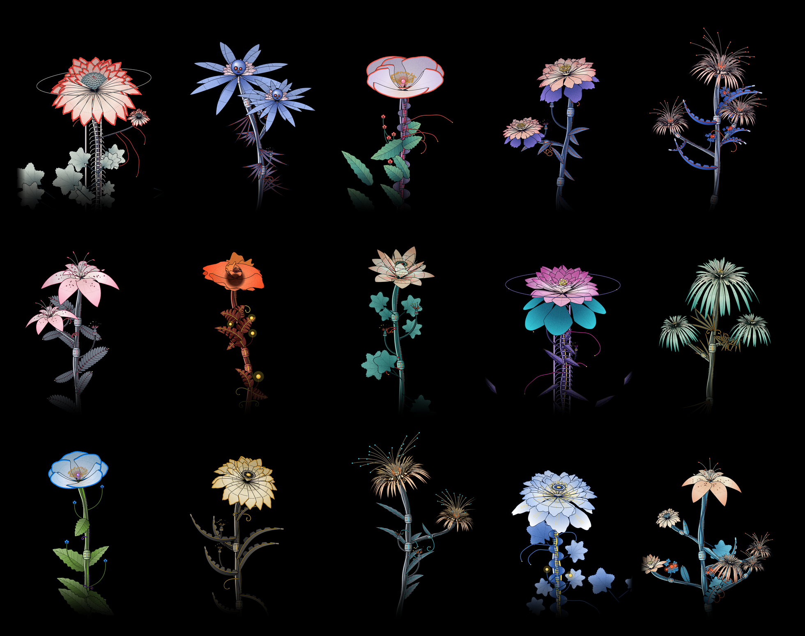
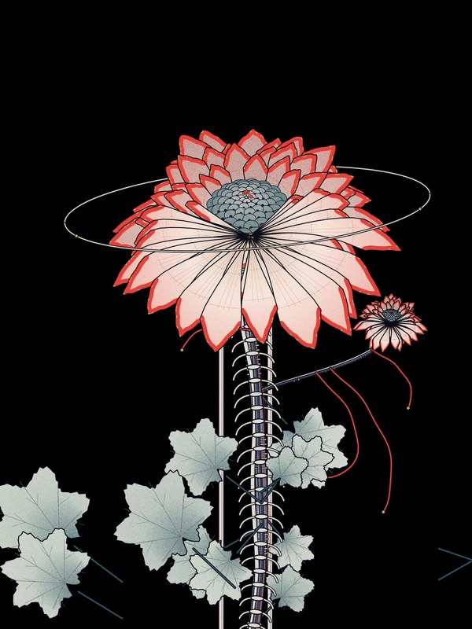
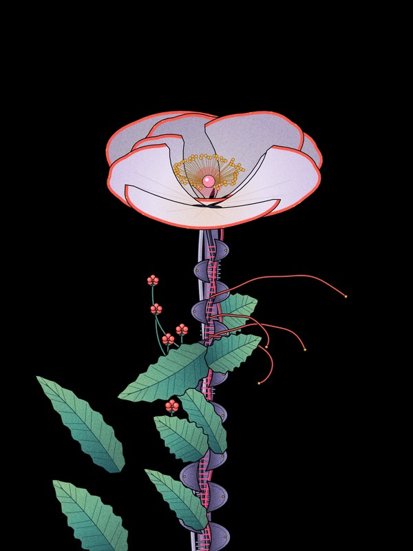
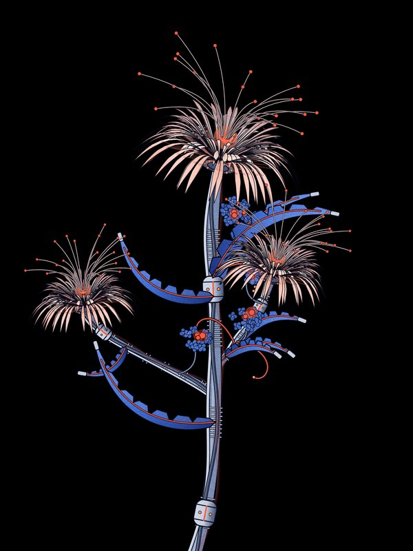
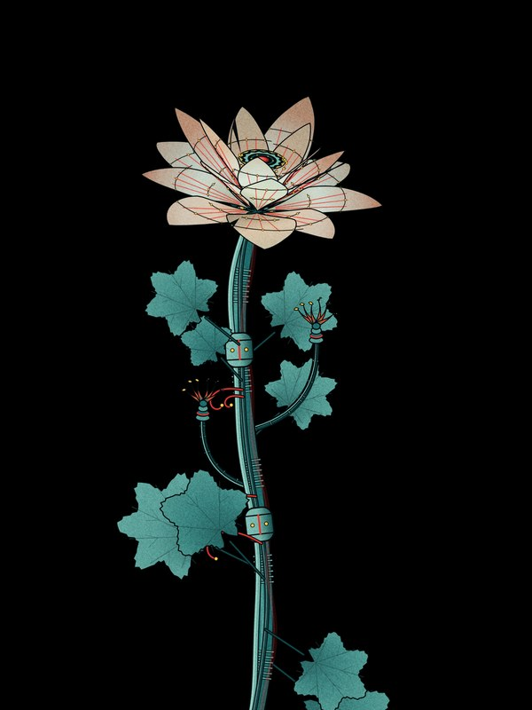

# HORTUS

**Procedural biomechanical flowers, drawn live in the browser.**

Hortus is a generator for flowers that are part plant, part machine. Move a slider and the specimen redraws instantly: petals open, stems turn into bundles of cables, blooms grow hydraulic arms and a geared iris. No AI images and no server. Every plant is drawn from code on a single canvas.

Created by **Ryuzi**.

---

## Run it

Hortus is one self-contained file. Download `index.html` and open it in any modern browser. It works offline: fonts, code and styles are all inside the file.

To host it, put `index.html` on any static host (GitHub Pages, Netlify, Vercel). There is no build step.

## What it does

| | |
|---|---|
|  |  |
|  |  |

**Presets.** One click loads a full composition: Star tower, Spider altar, Crown halo, Macro bloom, Armored rose and Classic.

**Compositions.** Single stem, a machine tower, an altar base with a rising pipe, a halo with a rib spine, an armored chassis, and a cropped macro view.

**Flowers.** Peony, Star, Spider lily, Crown mum, Wild rose, Lotus, Spider mum, Dahlia, Lily, Poppy, or Mixed. Flower centres can be set separately: stamens, robot eye, glowing filaments, scales, stamen ring or iris.

**Leaves.** Blade, Scythe, Lobed, Ovate, Split leaf, Frond, Spikes and Steel fin.

**Buds.** Claw, Berry, Orb and Hydrangea clusters.

**Machine.** Separate sliders turn the stem and the flower mechanical: ribbed sleeves, cables, bolted joints, steel petals with seams and rivets, hydraulic arms.

**Growth.** From one flower to 150 on a branching plant, with spread, height, sway and an animated wind.

**Colour.** 19 palettes, a random palette generator, and colour pickers for each part of the plant.

**Output.** Save any specimen as an 1800×2400 PNG. Each plant gets a made-up Latin name, like *Chrysanthemum cablifera*, which can be shown on the plate or hidden.

**Seeds.** The same seed and settings always produce the same plant, so any specimen can be recreated.

### Keyboard

| Key | Action |
|---|---|
| `N` | New seed |
| `R` | Randomize everything |
| `C` | Randomize colours |
| `W` | Toggle wind |

## How it works

Everything is drawn on an HTML canvas with plain JavaScript. There are no libraries.

- **Flowers** are built in 3D polar coordinates. Each petal is an outline with its own ruffle, tip shape, lift and curl, projected onto the screen and sorted back to front.
- **Stems** are Bézier paths. The machine layer wraps them in offset cable paths, ribs, joints, armour plates or bones.
- **Randomness** comes from a seeded generator, so a seed number always rebuilds the same plant.
- **Finish** is flat fills, inked outlines and a grain overlay, aiming for the look of a screen-printed poster.

## Credits

Concept, art direction and design: **Ryuzi**.

Typefaces: Geist Pixel by Vercel and Dot Matrix, both embedded in `index.html`.
